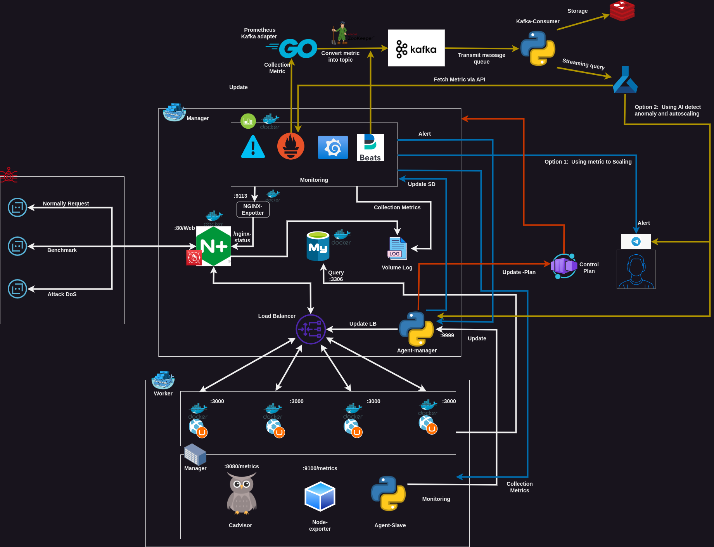
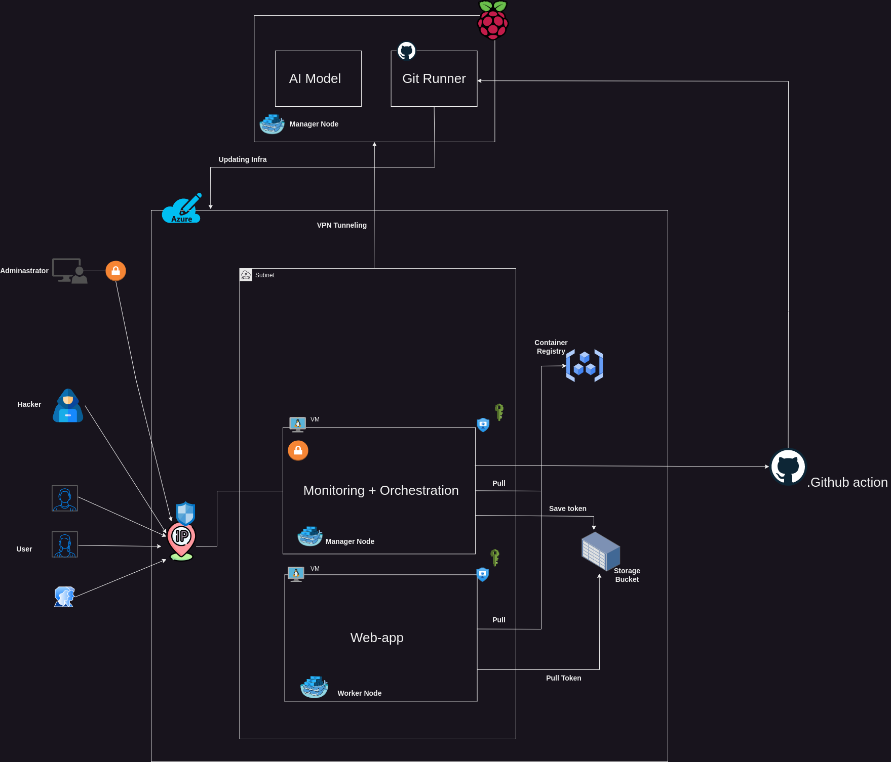

# NTMA_Anomaly

**Network Traffic Monitor and Analysis on anomaly detection for scaling infrastructure**

>[!NOTE]
>**Project is archived** and does not have any plan for continuous development !!!

*This repo is creature of by [@me](https://github.com/Xeus-Territory) and [@markpage2k1](https://github.com/MarkPage2k1). This is open source, experimental, and not limited, so if you want to contribute with Mark and me, contact me.*

## Purpose:
- The purpose of the project is to make the ideal about the HA (Highly Available) system, combining DevOps with automation and AI for intelligent action
- This way can be detected anomaly in network traffic by monitoring and analysis through log, metrics for deciding to automatically scale horizontally for any demand, or anything work with low latency at least
- Combining AI for anomaly detection can make the system flexible with data and can be dynamically scaled with a flex metric, not like using basic metrics or logs.
- Featured can be offered for detecting DDoS. (Not now, but feature this can be released)

## Project structure:  
- [Infrastructure](./Infrastructure/README.md):
    - Anything about the infrastructure includes Cloud, Docker, system design, and other components to deploy 
- [Script](./Script/README.md):
    - Everything about the build, setup, and deployment by Bash, Python, and Golang
- [ML-AI](./ML-AI/README.md)
    - Contain the ML and AI project inside for anomaly detection and make decisions
- Other:
    - Script file for building the agent and deployment agent for orchestrating and automating the system

## Requirements of the project
- 2 VM or more (including cadvisor, az-cli, node-exporter, docker, ...). Don't worry, everything I relate and even have the manual in the repo

## NTMA_Anomaly v0.1.0

**Local Infra**

**Cloud Infra**

---
# NTMA_Anomaly V0.2.0

- Have a new module for setting up a project with bash script `setup-all-ai.sh` or `setup-all-metric.sh`
- Have a new script file for building a new image with bash script `docker-build-image.sh`
